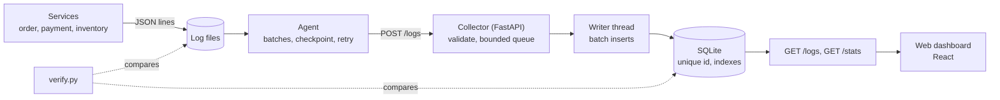

# Distributed Log Aggregation System

Many services write logs on different machines. This project collects them in one place, stores them without losing or duplicating any, and lets you search them in a web dashboard.

## The problem

When an application runs as several services, each one writes its own log files. Finding the cause of a failure means opening every machine and reading every file. If a machine or the network fails, logs can be lost. Resending after a failure creates duplicates, and a sudden burst of logs can overwhelm the receiver.

## What it does

- Collects JSON logs from several services through a lightweight agent
- Never loses a log when the collector is down: the agent retries with growing waits and resumes from a checkpoint
- Ignores duplicates, so resending is always safe
- Protects itself from overload with a bounded queue and HTTP 429 "slow down" answers
- Stores logs in a database with indexes, and searches by service, level, text and time
- Shows live logs, summary figures and an error-burst alert in a web dashboard
- Proves correctness with `verify.py`, which compares every log written with every log stored

## Architecture



**Life of one log:**
1. A service writes a JSON line with a unique id and a sequence number.
2. The agent reads new complete lines and groups up to 100 into a batch.
3. The agent sends `POST /logs`. The collector validates it and answers `202 Accepted`.
4. A writer thread saves the batch in one transaction and ignores duplicate ids.
5. Only after the `202` does the agent save its checkpoint.
6. The dashboard reads the log with `GET /logs`.

## Design decisions

| Problem | Technique | Why it works |
|---|---|---|
| Collector or network down | Log files act as the buffer; the agent retries after 1, 2, 4, 8 ... up to 30 seconds | Nothing is dropped until the collector accepts it |
| Agent restart | Checkpoint file with the read position of every log file | The agent resumes exactly where it stopped |
| Duplicates from retries | Unique `id` created by the service; the database ignores repeats | At-least-once delivery plus deduplication gives an effectively-once result |
| Overload | Queue limited to 10,000 logs; HTTP 429 with `Retry-After` | The collector protects itself and the agent waits |
| Slow search | Indexes on timestamp, service, level and trace_id | Queries stay fast as logs grow |
| Collector stopped with Ctrl+C | On shutdown the queue is saved before exit | No queued logs are lost |

## Repository layout

```
collector/collector.py    FastAPI collector: validates, queues, stores, serves queries
services/service.py       fake services that write logs
agent/agent.py            reads log files and sends batches to the collector
tools/verify.py           checks that every log written is stored
tools/load_test.py        speed test
tools/chaos.py            triggers an error burst for the alert demo
ui/                       web dashboard (React, TypeScript, Tailwind)
requirements.txt          Python libraries
```

## Run it

**Requirements:** Python 3.10 or newer, Node.js (LTS) for the dashboard, Git.

```
git clone https://github.com/Raghavendra-BM/distributed-log-system.git
cd distributed-log-system
pip install -r requirements.txt
cd ui
npm install
cd ..
```

Start each part in its own terminal, all in the project folder:

| Terminal | Command |
|---|---|
| 1. Collector | `cd collector` then `python -m uvicorn collector:app --port 8000` |
| 2. Services | `python services/service.py order payment inventory` |
| 3. Agent | `python agent/agent.py` |
| 4. Dashboard | `cd ui` then `npm run dev` |

Open the address that `npm run dev` prints, and click **Live API** at the top right. The collector's own API page is at `http://localhost:8000/docs`.

The dashboard expects the collector at `http://127.0.0.1:8000`. To use another address, create `ui/.env` containing `VITE_API_BASE_URL=http://your-address:8000` and restart `npm run dev`.

**Windows tips:** if PowerShell says running scripts is disabled when you use `npm`, run `Set-ExecutionPolicy -Scope Process Bypass` first. If `uvicorn` is not recognised, always start it as `python -m uvicorn`.

## Check that nothing is missing

```
python tools/verify.py --wait 20
```

It compares the unique id of every log in `logs/*.log` with the ids in the database and prints `PASS: 0 missing` or the missing sequence numbers. For a clean result, stop the services first and give the agent a few seconds to finish sending.

## Demos

**1. Collector outage.** With everything running, press `Ctrl+C` in the collector terminal. The agent starts retrying with growing waits while the services keep writing. After 30 seconds, start the collector again. Stop the services, then run `python tools/verify.py --wait 30`. It should report 0 missing.

**2. Agent crash.** Press `Ctrl+C` in the agent terminal, wait 10 seconds and start it again. It resumes from its checkpoint and `verify.py` still passes.

**3. Error burst and alert.** Run `python tools/chaos.py 30`. The services write mostly errors for 30 seconds, and the dashboard shows the red alert banner. `python tools/chaos.py off` ends the burst early.

**4. Speed test.** `python tools/load_test.py --total 10000` prints logs per second accepted and stored.

**Start with clean data:** stop everything, then delete the `logs` folder, `collector/logs.db` (and `logs.db-wal`, `logs.db-shm` if present) and `agent/checkpoint.json`.

## Log format

One JSON object per line:

```json
{
  "id": "b7e1c2a4-0d4f-4c1e-9a3b-6f2d8e1c7a55",
  "timestamp": "2026-10-10T10:15:03.120Z",
  "service": "payment",
  "level": "ERROR",
  "host": "node-1",
  "seq": 521,
  "message": "Card payment failed for order 4521"
}
```

`id` is created by the service, so a resent log keeps the same id. `seq` counts 1, 2, 3 ... per service, so gaps are visible. `timestamp` is always UTC.

## Collector API

| Endpoint | Purpose |
|---|---|
| `POST /logs` | Send one log or a list. `202` accepted, `429` overloaded (retry later), `422` invalid |
| `GET /logs` | Query with `service`, `level`, `trace_id`, `q` (text), `from`, `to`, `since_id`, `limit`. Newest first |
| `GET /stats` | Queue size, total logs and counts by level |

## Results

| Test | Outcome |
|---|---|
| End to end: 3 services, agent, collector, database | 732 logs written, 732 stored, 0 missing |
| Collector stopped during traffic, then restarted | 3,832 logs written, 3,832 stored, 0 missing |

All tests ran on a single laptop. The numbers show that the design works, not the limits of a real cluster.

